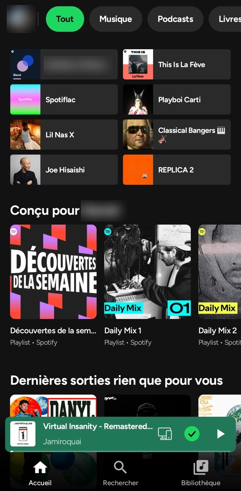
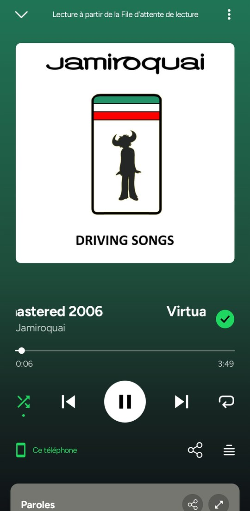
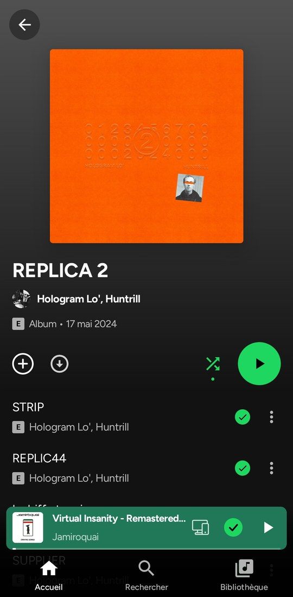

# WhenVanshListens (WhenVansh)

**A polished, personal, ad-free Android music companion.** Discover, organize, save, and intentionally listen to music in pure AMOLED black with electric-blue accents.
https://github.com/whenvanshcodes/WVL/tree/02a576ea0ca41191ad02a96de6e90074235a6da7/release
---

## Highlights

- 📥 **Music Inbox**: Save music discovered anywhere (browsers, Spotify, YouTube, Instagram, or social apps) via native Android share menu. Includes URL normalization, duplicate detection, listening statuses (`To Listen`, `Listening`, `Completed`, `Archived`), and local private storage.
- 🎯 **Listening Plans**: Set intentional music organization goals (finish albums, explore discographies, listen to recommendations) with honest progress tracking and resumption.
- 🗺️ **Sound Atlas**: An interactive 2D relationship graph on Compose Canvas to explore connections between artists, albums, and tracks using verified metadata, with pan & zoom.
- 🖤 **AMOLED Pure Black & Electric Blue**: Stunning dark design system tailored for OLED screens (`#000000` AMOLED black, `#0A0A0D` / `#111116` surfaces, `#3B82F6` / `#60A5FA` electric-blue accents).
- 🚫 **Ad-Free Experience**: No ad SDKs, banner ads, tracking, or sponsored promotions. Upstream player ad-break suppression preserved.
- 🎧 **Lossless Downloads & Synced Lyrics**: FLAC lossless audio caching, word-by-word synced lyrics, and music video integration.

---

## Architecture & Modules

```
myspoti-main/base
├── app/          # Jetpack Compose UI, ViewModels, MusicInbox, ListeningPlans, SoundAtlas, Widgets
├── api/          # Kotlin music entity models and streaming operations
├── api-spotify/  # Headless Spotify Web Player API bridge & GraphQL catalog
└── host-android/ # Android WebView host, PlaybackService, MediaSession, notifications
```

## Building and Testing

Prerequisites: JDK 21 (managed automatically via Gradle toolchain), Android SDK Build-Tools 36.0.0.

- **Run Unit Tests**:
  ```bash
  cd base
  .\gradlew.bat :app:testDebugUnitTest
  ```
- **Build Debug APK**:
  ```bash
  cd base
  .\gradlew.bat assembleDebug
  ```
  Output APK: `base/app/build/outputs/apk/debug/app-debug.apk`

- Detailed testing and verification instructions are in [docs/TESTING.md](docs/TESTING.md).
- Full implementation details and audit findings are in [docs/IMPLEMENTATION_REPORT.md](docs/IMPLEMENTATION_REPORT.md).

---

## Core Application Experience

**Listening**
- No ads (see above).
- Home, search, Browse, New releases, Your Library with folders, artist, album, playlist and profile pages, with Spotify's own content.
- Pick any song: shuffle, Smart Shuffle, the queue (drag to reorder), repeat, crossfade, sleep timer.
- Podcasts and audiobooks, with their own player (speed, ±15 s, mark as played).
- Spotify Connect, Jam, Bluetooth with your headphones' name, lock screen, notification, widget and Android Auto.

**Lyrics and videos**
- Synced lyrics, word by word when a source has the timing (or line by line, your choice in Settings), with translation.
- **Song meanings from Genius**: a light bulb for the story of the song, and a long press on an underlined line for its explanation, translated into your language.
- **Official music videos**, in sync with the song, in full screen if you like. Play them silently over the song, or hear the clip's own sound while the song keeps counting on Spotify.

**Your playlists**
- Create, edit (name, description, cover), sort, make public, private or collaborative.
- **Add songs** from a Spotify search inside the playlist, with suggestions.
- **Collaborative playlists**: invite friends with a link, see who is in, and who added each song.
- Share any song, album, artist or playlist as a **Spotify Code** (scannable in the Spotify app) or a link.

**Offline**
- Download songs, albums, playlists and Liked Songs, in **lossless FLAC** (CD or hi-res) or small AAC. The very recording is found by its ISRC on Tidal or Qobuz and checked before it is kept.
- Downloads are encrypted and stay in Myspoti. Lists you downloaded stay in step with Spotify.
- Your local audio files too.

**And also**
- Your recap: your top songs, artists and albums, kept on your phone.
- 7 languages: English, French, German, Spanish, Italian, Portuguese and Greek.
- Data saver, battery saver, AMOLED black, accent colour.

## New since 1.1

Version 2.0 is a new app, rebuilt from the ground up.

- 🚀 **A new engine**: faster screens, quicker skips, and playback that recovers by itself when Spotify's player stumbles.
- 🚫 **Ads stopped at the source** instead of skipped.
- 🎧 **Lossless downloads** (FLAC, hi-res) instead of YouTube audio, encrypted on your phone.
- 🎤 **Word-by-word lyrics**, from more sources, with **Genius song meanings**.
- 🎬 **Music videos with their own sound**, in full screen, in better quality.
- 👥 **Collaborative playlists**, an **Add songs** screen, and full playlist editing.
- 🔀 **Smart Shuffle**, a draggable queue, crossfade.
- 🎙️ **Podcasts and audiobooks** are back, with their own player and downloads.
- 📷 **Spotify Codes** to share, and profiles, Recents, Browse and New releases.
- 🌍 **Four new languages**, in-app updates and a diagnostic report you can send in one tap.

Every change is in the [changelog](CHANGELOG.md).

## Screenshots

| Home | Player | Artist | Album |
|:---:|:---:|:---:|:---:|
|  |  |  |  |

## Questions

**Is it safe for my account?** Myspoti talks to Spotify the way its web player does, and you sign in on Spotify's own page. Blocking ads is still against Spotify's Terms of Use (see the disclaimer below).

**"Spotify refused to play this"?** Some new or free accounts get refused by Spotify. Settings → **Export a diagnostic report** and send it on [Discord](https://discord.gg/jXKnGVFnGS) or in an [issue](https://github.com/kota-zo/myspoti/issues): it holds the app's recent log (what Spotify answered) and your phone's model, never your password or your login tokens.

**Do downloads count in my Wrapped?** No. Songs played from a download are not reported to Spotify; they count in Myspoti's own recap only. Streamed songs and music videos count as usual.

**What leaves my phone?** Your plays go to Spotify. Lyrics are looked up on lyrics sites, song meanings on Genius, translations on Google Translate, music videos on YouTube, and downloads on the Tidal or Qobuz sources. Nothing is sent to the developer.

## Not included

- No DRM circumvention, and no Spotify audio download: offline songs come from lossless catalogues, and a song with no lossless source is marked unavailable.
- No ad is ever marked as heard.

## Disclaimer

Blocking ads goes against Spotify's Terms of Use, and Spotify may suspend accounts that do it. Use this app at your own risk. If you can, support artists with Premium or by buying their music.

Not affiliated with or endorsed by Spotify. Spotify is a trademark of Spotify AB.

## Support

Myspoti is free, has no ads and is made in my spare time. If you enjoy it, you can support it on [Ko-fi](https://ko-fi.com/kotazo) or [GitHub Sponsors](https://github.com/sponsors/kota-zo), also from **About** in the app. Nothing is locked behind a donation.

News, help and ideas: the [Discord server](https://discord.gg/jXKnGVFnGS). Bugs and requests: [GitHub issues](https://github.com/kota-zo/myspoti/issues).

## For developers

The Android project is in `base/`, split in two:

- **`:api`** is the contract the UI talks to: plain Kotlin models and interfaces (player, search, catalog, library, playlists, home, podcasts, users, lyrics, devices, Jam).
- **`:api-spotify`** implements it on Spotify's Web Player. Playback stays in the official player, in a hidden WebView (`:host-android`), driven by a small bridge script. Catalog, search and library calls go straight to Spotify's servers. When Spotify ships a new Web Player, the app reads its new operation list by itself.
- **`:host-cdp`** runs the same API on desktop Chrome, so the whole API is tested against the real Web Player without a phone.

More: [`base/api-spotify/README.md`](base/api-spotify/README.md) and [`docs/api`](docs/api).

Requirements: JDK 17+ and the Android SDK (compileSdk 37).

```bash
cd base
./gradlew assembleDebug
./gradlew testDebugUnitTest
```

Live API tests (desktop Chrome with a signed-in Web Player):

```bash
google-chrome --user-data-dir="$HOME/.myspoti-chrome" --remote-debugging-port=9222
./gradlew :host-cdp:test -Pcdp=http://localhost:9222
```

Every push builds and tests on GitHub Actions. A `v*` tag publishes a signed APK in Releases.

## Credits

- UI derived from [Spotui](https://github.com/Spotui/Spotui) / [Metrolist](https://github.com/MetrolistGroup/Metrolist) (GPL-3.0); Spotui also gave the Kotlin port of the lossless resolver, the verification screen and the DASH-to-FLAC remux.
- [SpotiFLAC](https://github.com/spotbye/SpotiFLAC) (MIT): the lossless resolving idea and its community backend protocol.
- [SpotiFLAC Mobile](https://github.com/zarzet/SpotiFLAC-Mobile) (MIT) and its [extensions](https://github.com/zarzet/SpotiFLAC-Extension) (Apache-2.0): the signed download sessions and the Tidal / Qobuz requests.
- [NewPipeExtractor](https://github.com/TeamNewPipe/NewPipeExtractor) (GPL-3.0): music videos.
- Lyrics: [LRCLIB](https://lrclib.net), LyricsPlus, lrc.red, Kugou and NetEase; song meanings: [Genius](https://genius.com).
- [Material Icons](https://github.com/google/material-design-icons) (Apache 2.0) and the [Figtree](https://github.com/erikdkennedy/figtree) font (SIL OFL 1.1, see `base/licenses/`).

Full notices: [`THIRD_PARTY_NOTICES.md`](THIRD_PARTY_NOTICES.md).

## License

GPL-3.0.
